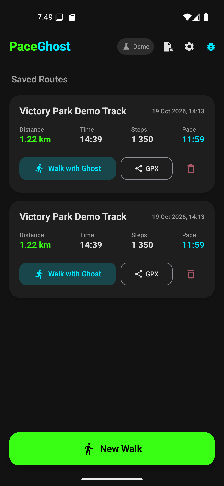
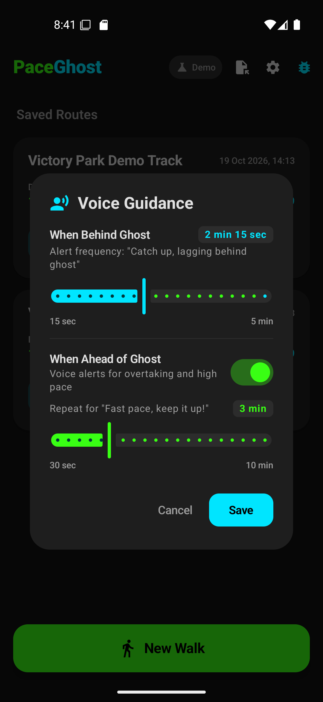
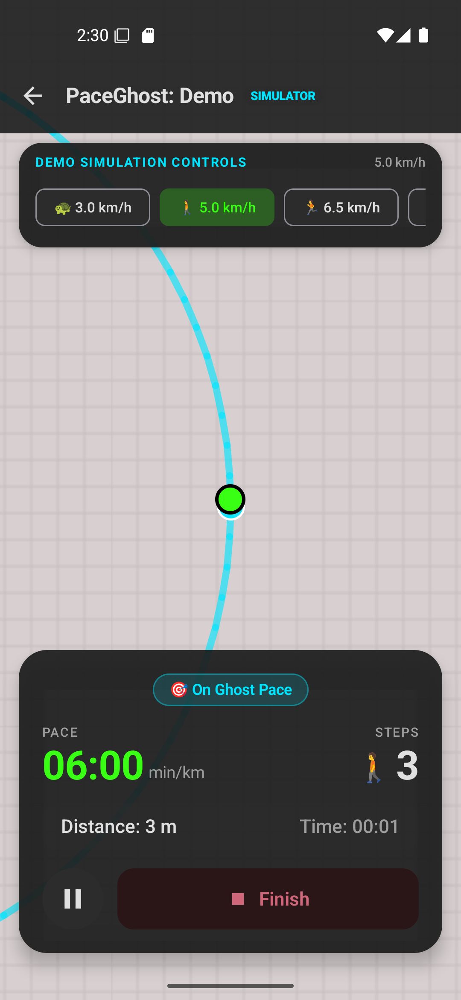
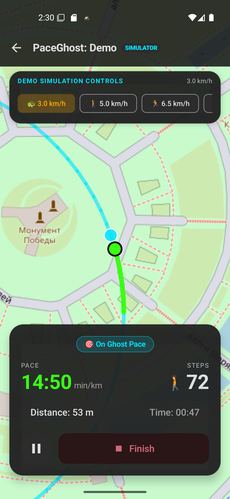
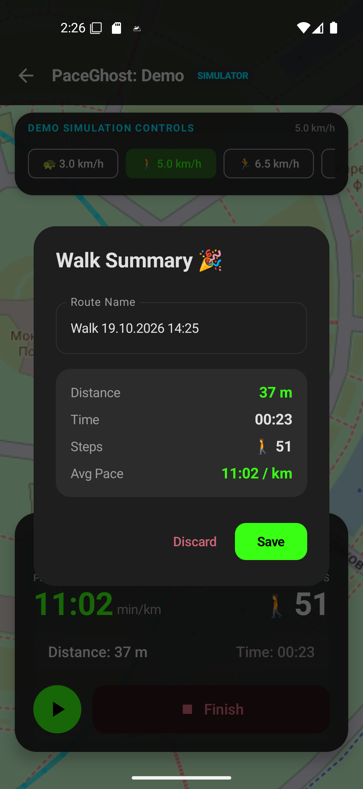

# PaceGhost 👻🚶

Минималистичный Android-трекер активности с функцией **«Призрак» (Ghost Pacing)** и тактильной обратной связью (вибрация) для контроля темпа ходьбы и прогулок.

Приложение позволяет записывать треки прогулок, сохранять их локально, импортировать/экспортировать в формате GPX и соревноваться с собственным лучшим временем на том же маршруте без постоянного взгляда на экран смартфона.

---

## 🌟 Основные возможности

1. **Минималистичный дизайн (OLED Dark UI)**:
   - Контрастная ночная тема (`#121212`) с яркими неоновыми акцентами для экономии заряда батареи и четкой видимости на солнце.
   - Минимальное количество отвлекающих элементов: только карта OpenStreetMap и полупрозрачная плашка с ключевыми метриками (шаги, темп, расстояние, время, дельта отставания/опережения).

2. **Режим «Призрак» (Ghost Pacing)**:
   - Возможность выбрать любой ранее пройденный маршрут и бросить вызов «Призраку».
   - Математическая ортогональная проекция текущей позиции на сегменты опорного трека с интерполяцией времени прохождения.
   - Определение статуса:
     - 🟢 **Впереди** (AHEAD): темп выше времени призрака на > 15 с.
     - ⚪ **В темпе** (ON_PACE): отклонение в пределах ±15 с.
     - 🟠 **Отставание** (BEHIND): отставание от призрака более чем на 30 с.
     - ⚪ **Вне маршрута** (OFF_ROUTE): если расстояние до опорного трека превышает 60 метров.

3. **Тактильная обратная связь (Умная вибрация)**:
   - При отставании более чем на 30 секунд телефон подает **двойной виброимпульс** (150 мс — 100 мс пауза — 250 мс), предупреждая о необходимости прибавить шаг.
   - Встроен кулдаун (не чаще одного раза в 60 секунд), чтобы вибрация не раздражала.
   - При обгоне призрака (переход из отставания в опережение) подается ободряющий **одиночный импульс** (200 мс).

4. **Голосовые подсказки для наушников (Audio Ducking TTS & Voice Guidance Settings)**:
   - Полная тишина в темпе призрака (`ON_PACE`) — приложение не мешает музыке или подкастам.
   - Настраиваемый интервал повтора оповещений прямо из диалога настроек на главном экране (иконка ⚙️):
     - При отставании: настраиваемый кулдаун от 15 секунд до 5 минут (*"Catch up, lagging behind ghost"*).
     - При опережении: настраиваемый кулдаун от 30 секунд до 10 минут (*"Fast pace, keep it up!"*), либо полное отключение голосовых оповещений при опережении (Silent mode).
   - При обгоне звучит: *"Great pace, ghost is behind!"*.
   - При сходе с трека (> 60 м) звучит предупреждение: *"You are off route"*.
   - Движок TTS настроен на английскую локаль (`Locale.US`).
   - Поддержка Audio Ducking: фоновое аудио в наушниках плавно приглушается на время фразы и сразу восстанавливается.
   - Быстрый переключатель звука (🔊 / 🔇) в верхнем баре экрана ходьбы.

5. **Умная авто-пауза**:
   - Автоматически приостанавливает расчет времени при остановке (например, на светофорах при скорости < 0.5 км/ч более 7 секунд) и автоматически возобновляет при начале движения, предотвращая ложные срабатывания вибрации.

6. **Шагомер и GPS-трекинг**:
   - Аппаратный подсчет шагов через датчик `Sensor.TYPE_STEP_COUNTER` с компенсацией базового смещения.
   - Фоновый сервис с непрерывным уведомлением Foreground Service (`FOREGROUND_SERVICE_LOCATION` + `FOREGROUND_SERVICE_HEALTH`).

7. **Демо-режим для тестирования дома**:
   - Переключатель «Демо-режим» позволяет симулировать реальную прогулку по тестовому треку (Парк Победы) с выбором скорости прямо на экране:
     - `3.0 км/ч` (замедление, вызывает отставание и вибрацию);
     - `5.0 км/ч` (нормальный темп);
     - `6.5 км/ч` (ускорение, обгон призрака);
     - `Стоп` (светофор, проверка авто-паузы);
     - `Off-route` (уход с маршрута).

8. **GPX Импорт / Экспорт**:
   - Полная поддержка формата GPX 1.1 для переноса треков между сервисами.

9. **Подписанный релизный ключ**:
   - Дистрибутив приложения подписан постоянным релизным ключом (RSA 2048, валидность 10 000 дней) для бесшовных обновлений в RuStore / Комистор.

---

## 🛠 Технологический стек

- **Язык**: Kotlin 2.0 (JVM 17)
- **UI**: Jetpack Compose, Material 3
- **Карты**: OsmDroid (OpenStreetMap — без обязательных внешних API-ключей Google Maps)
- **База данных**: Room (SQLite) с миграциями и начальным сидированием демо-трека
- **Архитектура**: Clean Architecture + MVVM + StateFlow / SharedFlow
- **Фоновая работа**: Android Foreground Service + SensorEventListener + FusedLocationProviderClient
- **Тесты**: JUnit 4 (Unit-тесты геометрии `GeoMath`, `GhostEngine`, автопаузы и GPX)

---

## 🚀 Сборка и запуск

### Требования
- JDK 17
- Android SDK (compileSdk 35, minSdk 26)

### Сборка релизного APK
```bash
./gradlew assembleRelease
```
Файл APK будет сгенерирован по пути:
`app/build/outputs/apk/release/app-release.apk`

---

## 📱 Скриншоты приложения (English UI)

| Home Screen | Voice Guidance Settings | Active Walk & Map | Simulation Controls & Auto-pause | Walk Summary |
| :---: | :---: | :---: | :---: | :---: |
|  |  |  |  |  |
| Исправленная шапка и треки | Настройка интервалов речи | Карта OsmDroid с HUD и призраком | Управление симуляцией и автопауза | Сохранение трека и сводка |
